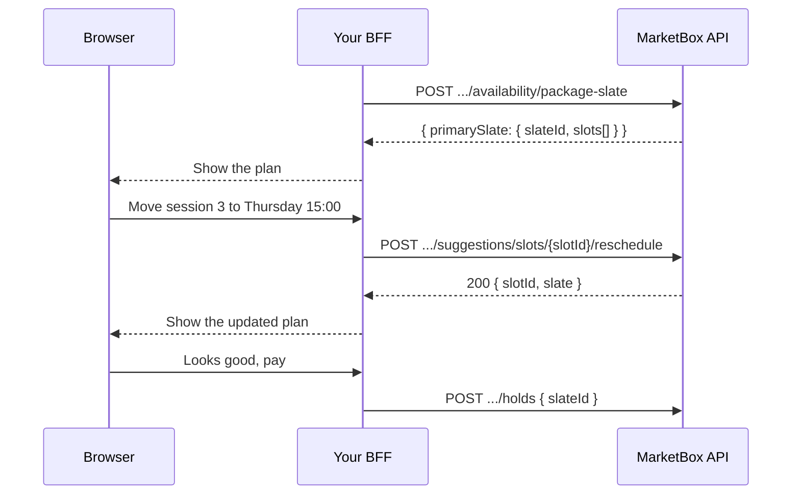

A package slate is a proposal: every session of a package, with one
supplier, at times the availability engine picked. Clients often like the
plan but not one date. "Can we do Thursday instead?" is the step this guide
builds.

You move one session with
`POST /v1/projects/{projectId}/suggestions/slots/{slotId}/reschedule`. The
server checks the new time against the supplier's real calendar. On success,
it returns the whole updated slate, so you can show it and then hold or book
it.

It builds on two guides. Read them first if you haven't:

- [Availability and slates](/guides/availability-and-slates): how a slate is
  planned and what its fields mean.
- [Create a package booking with a slate](/guides/create-a-package-booking)
  or [Book a client's package credit](/guides/book-a-package-credit): how a
  slate is booked.

For every field and refusal of the reschedule route, see
[Rescheduling a slot](/resources/suggestions#rescheduling-a-slot).

<Note>
The reschedule route takes the `x-api-key` header alone. There is no
client-plane version, so call it from your BFF, even in a flow where the
client is signed in. The slate stays tied to the order item it was planned
from. So if you planned it from the client's own credit (`orderId` and
`orderItemId`), and that order is `PAID`, the client can still book it on the
client plane afterwards.
</Note>

## How it works

1. **Plan a stored slate.** `POST /availability/package-slate` (or
   `package-options`) without `persist: false`. Only a stored slate has
   `slotId`s you can move.
2. **Show it, and let the client pick a session to move.** Each slot has a
   `slotId`.
3. **Move the session.** `POST /suggestions/slots/{slotId}/reschedule` with
   the new `bookingStartUtc`.
4. **Re-render from the response.** The `200` carries the whole slate.
   Replace what you show with it.
5. **Hold or book the slate.** Use the same `slateId` as before. The hold or
   booking picks up the new time.



## Move one session

Send the new start as a UTC instant in `Z` form, such as
`2026-07-16T20:00:00.000Z`. An offset form such as `…-05:00` is a
`400 VALIDATION_ERROR`. Only the start moves: the session keeps
its length, its time zone, its place and its supplier.

```json
// POST /v1/projects/{projectId}/suggestions/slots/{slotId}/reschedule
{ "bookingStartUtc": "2026-07-16T20:00:00.000Z" }
```

Turn the client's local choice into an instant in the slot's `bookingTz`.
See [Time zones](/concepts/timezones).

To offer times that are likely to pass, search that day first with
`POST /availability/suppliers` and use the slate supplier's entry. See
[Search suppliers by availability](/guides/search-suppliers-by-availability).
The reschedule checks the time again either way.

### What the server checks

- The slot still exists, and its slate is within its 24-hour window.
- The new time is in the future.
- The supplier works then, and no booking or blocked time is in the way.
- No live hold covers the new time on the supplier's calendar.

Three things it doesn't check, so check them yourself before you send:

- **The other sessions of the slate.** The server doesn't stop two sessions
  from landing on the same time, or too close to travel between.
- **The package's expiry.** A session moved past the credit's `expiresAt`
  is accepted here, then refused with `409 PACKAGE_EXPIRED` when you book or
  convert it.
- **The plan's cadence.** A moved slate can drift from its own
  `cadenceRrule`, which still records how it was first planned.

## Re-render from the response

The `200` returns the moved slot's id and the whole slate:

```json
{
  "slotId": "slot_01kx16ejsqffc9rbgdcc591w2q",
  "slate": {
    "slateId": "slate_01kx16ejsqffc9rbgdcc591w2p",
    "supplierId": "sup_01kv60qgnef2kt3pvqgwmkbzfr",
    "completeness": "COMPLETE",
    "startTimeConsistencyPercent": 75,
    "totalTravelTimeMins": 40,
    "slots": []
  }
}
```

(`slots[]` is abridged.) Replace the slate you show with this one. Don't
patch the one slot on your side: the slate's totals changed too.

- `startTimeConsistencyPercent` is worked out again.
- `totalTravelTimeMins` doesn't change: every session keeps its planned
  travel estimate, including the moved one.
- `cadenceSummary` reflects the new times.
- `matchScore`, `matchComponents`, `matchNotes` and the cadence fields keep
  the values from planning.
- `slots[]` stays in `sessionIndex` order. A moved session can now fall
  after a later one, so sort by `bookingStartUtc` to show the plan in date
  order.

**A reschedule reserves nothing.** The new time is free when the call
returns, but anyone can take it before you hold it.

## When the move is refused

Branch on `code`, not on the status: nearly every refusal is a `409`, and
each needs a different answer.

```ts
// app/api/bff/slots/[slotId]/reschedule/route.ts
const res = await fetch(
  `${process.env.MARKETBOX_API_URL}/v1/projects/${process.env.MARKETBOX_PROJECT_ID}/suggestions/slots/${slotId}/reschedule`,
  {
    method: 'POST',
    headers: {
      'x-api-key': process.env.MARKETBOX_API_KEY!, // server-only
      'content-type': 'application/json',
    },
    body: JSON.stringify({ bookingStartUtc }),
  },
);
const body = await res.json();

if (res.ok) return { kind: 'moved', slate: body.slate };

switch (body.code) {
  case 'SLOT_TIME_UNAVAILABLE': // off shift, or a booking or blocked time is in the way
  case 'SLOT_HELD':             // a hold covers that time
  case 'SLOT_BOOKED':           // a booking claim the first check missed (rare)
    return { kind: 'pick-another-time', message: body.message };
  case 'SLOT_NO_LONGER_FREE':   // lost a race: retry once
    return { kind: 'retry-once' };
  case 'SUGGESTION_EXPIRED':
  case 'SLOT_NOT_BOOKABLE':
  case 'SLATE_NOT_FOUND':
  case 'SLOT_NOT_FOUND':
    return { kind: 'replan', freshSuggestions: body.freshSuggestions ?? null };
  default:
    return { kind: 'error', requestId: body.requestId };
}
```

### The time isn't free

The slate is unchanged. Ask the client for another time.

`SLOT_TIME_UNAVAILABLE` is the usual answer. It covers a time the supplier
doesn't work, and a time a booking or blocked time is already in. It names
the supplier, the time and the length, but not what's in the way:

```json
{
  "code": "SLOT_TIME_UNAVAILABLE",
  "message": "Supplier sup_01kv60qgnef2kt3pvqgwmkbzfr is not available at 2026-07-16T20:00:00.000Z for 60 minutes",
  "statusCode": 409,
  "requestId": "5c2e8a1f-7d4b-4e69-b0a3-1f9d6c2e8b47"
}
```

`SLOT_HELD` means a hold covers the time. `SLOT_BOOKED` is rare: a booking
the first check didn't see. Both carry `conflicts[]`, naming the hold or
booking in the way. See
[The three supplier-time conflicts](/concepts/concurrency#the-three-supplier-time-conflicts).

### You lost a race

`SLOT_NO_LONGER_FREE` means the slot or its slate was removed, or a
concurrent write cancelled the move. It carries **no** `freshSuggestions`.
Retry once. If it fails again, plan a new slate.

```json
{
  "code": "SLOT_NO_LONGER_FREE",
  "message": "Slot slot_01kx16ejsqffc9rbgdcc591w2q could not be rescheduled (no longer FREE or not found)",
  "statusCode": 409,
  "requestId": "2f7a4c9e-1b6d-4a83-b5e0-8d3c1f7a2e96"
}
```

### The slate went stale

A slot past its 24-hour window is `SUGGESTION_EXPIRED`. The response carries
`freshSuggestions`: a new plan, worked out from the original request, in the
shape of a `POST /availability/package-slate` response. Show its
`primarySlate` instead of starting a new search:

```json
{
  "code": "SUGGESTION_EXPIRED",
  "message": "Slot slot_01kx16ejsqffc9rbgdcc591w2q is past its resolvable window",
  "statusCode": 409,
  "requestId": "8b1d5f3a-6c2e-4d97-a0b4-3e7f9c1a5d28",
  "freshSuggestions": {
    "status": "OK",
    "suggestionRequestId": "sugreq_01kx19m3x7ab4c2d9e5f6g7h8j",
    "primarySlate": { "slateId": "slate_01kx19m3x7ab4c2d9e5f6g7h8k", "slots": [] }
  }
}
```

(`freshSuggestions` is abridged.) The new slate has new ids, and the client's
earlier moves aren't in it.

Check before you show it:

- `freshSuggestions` is `null` when no new plan could be made: for
  `SLOT_NOT_FOUND`, or when the credit it was planned from is used up,
  expired or cancelled.
- `freshSuggestions.primarySlate` can be `null` too, as with
  `status: "NO_AVAILABILITY"`.

In either case, plan again yourself.

A past or malformed `bookingStartUtc` is a `400`. The slot is checked first,
so a past time on a stale slot gets the stale `409`. The full list is in
[When a reschedule is refused](/resources/suggestions#when-a-reschedule-is-refused).

## Hold or book the adjusted slate

The moved slot is stored, so the same `slateId` now means the new times.

- **To hold while the client pays**, `POST /holds` with the `slateId`. See
  [Hold slots during checkout](/guides/hold-slots-for-checkout).
- **To book now**, `POST /orders/{orderId}/package-bookings` with the
  `slateId`. See
  [Create a package booking](/guides/create-a-package-booking).
- **To book a signed-in client's credit**,
  `POST /clients/me/orders/{orderId}/package-bookings`. See
  [Book a client's package credit](/guides/book-a-package-credit).

Each of these checks the times again. A time that was free when you moved
the slot may have been taken since.

Moving a slot doesn't extend the slate's 24-hour window. `resolvableUntil`
still counts from the original planning call, and holding the slate after
then is `409 SUGGESTION_EXPIRED`. See [Refusals](/resources/holds#refusals).

### Move sessions before you hold, not after

A reschedule changes the slate only. A hold or booking you already made keeps
its old time. Two more things follow:

- **Your own hold counts as a conflict.** Moving a slot into time you hold
  yourself is `409 SLOT_HELD`, naming your own `reservationId`.
- **A held slate doesn't follow the move.** Converting the hold books the
  old times.

So let the client finish adjusting before you hold. If they want a change
after you've held:

1. Release the hold: `POST /holds/{reservationId}/release`.
2. Move the session.
3. Hold the `slateId` again.

## Adjust a slate or reschedule a booking?

| | Adjust a slate | Reschedule a booking |
| --- | --- | --- |
| When | Before anything is booked. | After the session is booked. |
| Call | `POST /suggestions/slots/{slotId}/reschedule` | `PATCH /bookings/{bookingId}` |
| You send | The new start. The length is kept. | Both ends. |
| What it checks | The supplier's hours, blocked time, bookings and holds. | Only bookings and holds. Not the supplier's hours. |
| What changes | A proposal. Nothing is reserved. | A real booking. Everyone is emailed. |
| Can change the supplier | No. | Yes. |

To move a session that's already booked, see
[Reschedule a booking](/guides/cancel-or-reschedule-a-booking#reschedule-a-booking).

## Reference

### Endpoints used in this guide

| Endpoint | Method | Description |
| --- | --- | --- |
| `/v1/projects/{projectId}/availability/package-slate` | `POST` | Plan a stored slate. Returns `primarySlate.slateId` and `slots[].slotId`. |
| `/v1/projects/{projectId}/suggestions/slots/{slotId}/reschedule` | `POST` | Move one session. Returns `{ slotId, slate }`. |
| `/v1/projects/{projectId}/availability/suppliers` | `POST` | Find times the supplier can work. |
| `/v1/projects/{projectId}/holds` | `POST` | Hold the adjusted slate by `slateId`. |
| `/v1/projects/{projectId}/holds/{reservationId}/release` | `POST` | Free a hold so the slate can be adjusted again. |
| `/v1/projects/{projectId}/orders/{orderId}/package-bookings` | `POST` | Book the adjusted slate by `slateId`. |

### Errors and edge cases

| Scenario | `code` | Status | Resolution |
| --- | --- | --- | --- |
| The supplier doesn't work then, or a booking or blocked time is in the way | `SLOT_TIME_UNAVAILABLE` | `409` | Offer another time. The slate is unchanged. |
| A hold covers the new time, or (rarely) a booking the first check missed | `SLOT_HELD`, `SLOT_BOOKED` | `409` | Offer another time. |
| The new time is in your own hold | `SLOT_HELD` | `409` | Release the hold, move the session, then hold again. |
| A concurrent write cancelled the move | `SLOT_NO_LONGER_FREE` | `409` | Retry once. No `freshSuggestions`. |
| The slot is past its 24-hour window | `SUGGESTION_EXPIRED` | `409` | Show `freshSuggestions.primarySlate`, if it isn't `null`. |
| The slot or slate can no longer be used | `SLOT_NOT_BOOKABLE`, `SLATE_NOT_FOUND` | `409` | Show `freshSuggestions.primarySlate`, if it isn't `null`. |
| No slot has that id | `SLOT_NOT_FOUND` | `409` | Plan a new slate. `freshSuggestions` is `null`. |
| The new time is in the past | `BAD_REQUEST` | `400` | Send a future time. |
| `bookingStartUtc` isn't a UTC (`Z`) ISO-8601 instant | `VALIDATION_ERROR` | `400` | Send it in `Z` form. |
| A moved session falls after the credit's `expiresAt` | `PACKAGE_EXPIRED` | `409` | Raised when you book or convert. Move the session earlier first. |
