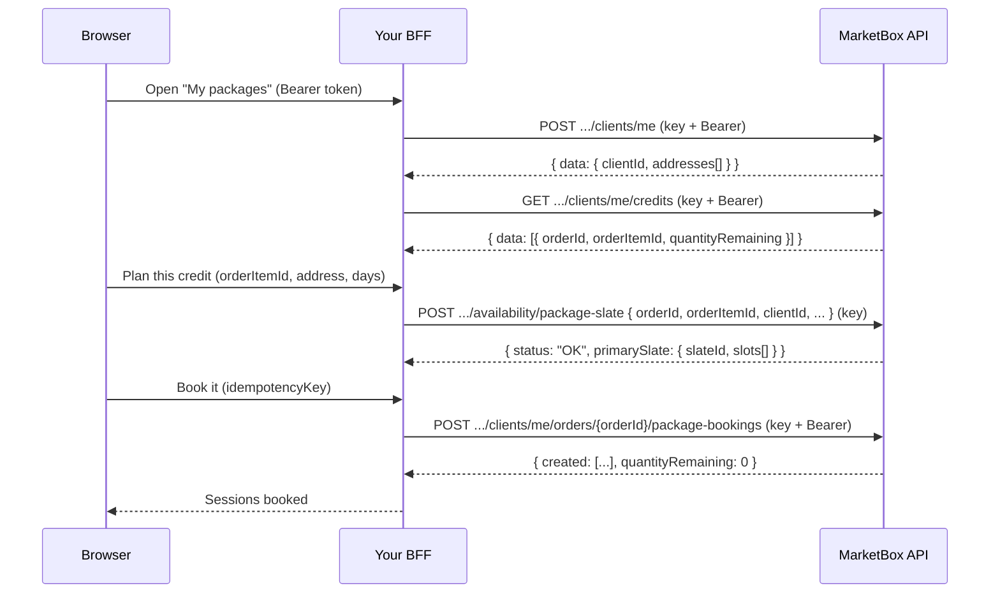

This guide is for a client who **already owns a package credit** and comes
back to your booking flow to schedule it. They may have bought the package
earlier and never booked it. Or a cancellation may have returned some sessions
to it. Either way, there is no new order and no payment: the client spends
sessions they already paid for.

The flow plans one **slate** from the credit and books the whole slate with a
single call, like [Create a package booking with a slate](/guides/create-a-package-booking).
The difference is who acts. The client is signed in, so the booking call runs
on the **client plane**, as that client.

It builds on two guides. Read them first if you haven't:

- [Build a booking flow](/guides/booking-flow-auth) — hosted sign-in, the
  [BFF pattern](/guides/booking-flow-auth#the-bff-pattern), and onboarding.
- [Create a package booking with a slate](/guides/create-a-package-booking) —
  how slates are planned and booked.

<Note>
Every call goes through your BFF, which attaches the `x-api-key` header. Three
of the four calls also forward the client's `Authorization: Bearer <token>`.
The browser never sees the API key.
</Note>

| Call | `x-api-key` | `Bearer` (the client's token) |
| --- | --- | --- |
| `POST /clients/me` | Yes | Yes |
| `GET /clients/me/credits` | Yes | Yes |
| `POST /availability/package-slate` | Yes | No |
| `POST /clients/me/orders/{orderId}/package-bookings` | Yes | Yes |

## How it works

Booking a credit is four calls, always in this order:

1. **Identify the client.** `POST /clients/me` returns the signed-in client's
   profile: their `clientId` and their saved addresses.
2. **List their credits.** `GET /clients/me/credits` returns every package
   credit the client can book, with the sessions left on each. The client
   picks one.
3. **Plan the slate from the credit.** `POST /availability/package-slate` with
   the credit's `orderId` and `orderItemId`, the client's `clientId`, a
   location and an `rrule` returns a `primarySlate` with a `slateId`.
4. **Book the slate as the client.** `POST /clients/me/orders/{orderId}/package-bookings`
   with `{ orderItemId, idempotencyKey, slateId }` books every session in one
   call and draws them from the credit.



<Note>
**Only paid credits can be booked here.** `GET /clients/me/credits` lists a
credit only when its order is `PAID`, and the booking call refuses any credit
that list would leave out. That is stricter than the API-key route, which also
books from `DRAFT` and `PENDING` orders. A client who hasn't paid yet should
finish checkout first. See [Accept payments with Stripe](/guides/accept-payments-with-stripe).
</Note>

<Steps>
<Step title="Identify the client">
Call `POST /clients/me` with both credentials. It onboards a first-time client
(`201`) and returns the existing profile on every later call (`200`), so it is
safe to call whenever the client opens their packages. See
[Onboard the client](/guides/booking-flow-auth#onboard-the-client).

```ts
// lib/marketbox.ts — shared by the BFF routes below
export const project = process.env.MARKETBOX_PROJECT_ID!;

export function bearerFrom(request: Request): string | null {
  const auth = request.headers.get('authorization');
  return auth?.toLowerCase().startsWith('bearer ') ? auth : null;
}

export async function marketbox(path: string, init: RequestInit & { bearer?: string } = {}) {
  const { bearer, headers, ...rest } = init;
  return fetch(`${process.env.MARKETBOX_API_URL}${path}`, {
    ...rest,
    headers: {
      'x-api-key': process.env.MARKETBOX_API_KEY!, // server-only
      'content-type': 'application/json',
      ...(bearer && { authorization: bearer }),
      ...headers,
    },
  });
}

// The signed-in client's profile. Call it from the server, never trust a
// clientId sent by the browser.
export async function myProfile(bearer: string) {
  const res = await marketbox(`/v1/projects/${project}/clients/me`, { method: 'POST', bearer });
  if (!res.ok) throw Object.assign(new Error('onboarding failed'), { status: res.status });
  return (await res.json()).data as {
    clientId: string;
    addresses?: Array<{
      addressOneLine: string;
      streetNumber: string;
      streetName: string;
      city: string;
      state: string;
      country: string;
      zipCode: string;
      unitNumber?: string | null;
      latitude?: number | null;
      longitude?: number | null;
    }>;
    defaultAddressId?: string;
  };
}
```

The response is the client profile under `data` (abridged):

```json
{
  "data": {
    "clientId": "cli_01kx0z7m3qe6r2ts8vwbydca4n",
    "firstName": "Emma",
    "lastName": "Bishop",
    "addresses": [
      {
        "addressOneLine": "100 Queen St W, Toronto, ON M5H 2N2, Canada",
        "streetNumber": "100",
        "streetName": "Queen St W",
        "city": "Toronto",
        "state": "ON",
        "country": "CA",
        "zipCode": "M5H 2N2",
        "latitude": 43.6532,
        "longitude": -79.3832
      }
    ]
  }
}
```

Keep two things from it on the server: `clientId` for Step 3, and the
addresses the client can pick from.

<Warning>
**Two different things are called `clientId`.** The OAuth `clientId`
(`NEXT_PUBLIC_OIDC_CLIENT_ID`) identifies your Application to hosted login.
The MarketBox `clientId` (`cli_…`) identifies the **person** in this project.
Step 3 needs the `cli_` one, read from this response.
</Warning>
</Step>

<Step title="List the client's credits">
`GET /clients/me/credits` returns the credits the client can book. Each entry
is one `PACKAGE` order item they own:

```ts
// app/api/bff/credits/route.ts
import { NextResponse } from 'next/server';
import { bearerFrom, marketbox, project } from '@/lib/marketbox';

export async function GET(request: Request) {
  const bearer = bearerFrom(request);
  if (!bearer) return NextResponse.json({ message: 'Missing bearer token' }, { status: 401 });

  const res = await marketbox(`/v1/projects/${project}/clients/me/credits`, { bearer });
  const body = await res.json().catch(() => ({}));
  return NextResponse.json(body, { status: res.status });
}
```

```json
{
  "data": [
    {
      "orderId": "ord_01kx16f0a1c7b2sd91xzq3mn5p",
      "orderItemId": "oi_01kx16f0a1d8c3se02yzq4mn6q",
      "packageId": "pkg_01kvr4cgb3esg8hxx32kwhre7g",
      "serviceId": "srv_01kv60qg12e82acr78edfnjhvv",
      "offeringId": "off_01kv60qge5eh59ap0gw0pqrrys",
      "quantity": 8,
      "quantityAllocated": 5,
      "quantityRemaining": 3,
      "quantityReturned": 1,
      "unitPrice": { "amount": 5625, "currency": "CAD" },
      "expiresAt": "2026-12-06T00:00:00.000Z",
      "orderStatus": "PAID"
    }
  ]
}
```

Show each credit with its sessions left and its expiry:

- **`quantityRemaining`** is how many sessions the client can book now. It is
  the session count the slate in Step 3 plans.
- **`expiresAt`** is the last moment a session can start. `null` means the
  credit never expires.
- **`quantityReturned`** counts sessions cancellations gave back, ever. It is
  already inside `quantityRemaining`. Use it for copy such as "1 session was
  returned to your package", never to compute a balance.
- **`packageId`** can be `null`, and the package may since have been edited
  or deleted. The credit still books: it keeps the service and offering it
  was sold with. Name it from `serviceId` and `offeringId`.

A client with no credits gets `200` with `data: []`. Used-up, expired and
removed credits are left out, and so are credits on unpaid or cancelled
orders.
</Step>

<Step title="Plan the slate from the credit">
When the client picks a credit, your BFF plans it with
`POST /availability/package-slate`. Send the credit's `orderId` and
`orderItemId` **in place of** `packageId`, plus the client's `clientId` from
Step 1. This call takes only the API key.

```ts
// app/api/bff/credits/plan/route.ts
import { NextResponse } from 'next/server';
import { bearerFrom, marketbox, myProfile, project } from '@/lib/marketbox';

export async function POST(request: Request) {
  const bearer = bearerFrom(request);
  if (!bearer) return NextResponse.json({ message: 'Missing bearer token' }, { status: 401 });

  // From the browser: which credit, which saved address, and the cadence.
  const { orderId, orderItemId, addressIndex, rrule, lookAheadStartDate } = await request.json();

  const { clientId, addresses = [] } = await myProfile(bearer);
  const a = addresses[addressIndex];
  if (!a || a.latitude == null || a.longitude == null) {
    return NextResponse.json({ message: 'Pick an address with coordinates' }, { status: 400 });
  }

  const res = await marketbox(`/v1/projects/${project}/availability/package-slate`, {
    method: 'POST',
    body: JSON.stringify({
      orderId,
      orderItemId,
      clientId, // MarketBox refuses an order that isn't this client's
      lat: a.latitude,
      lng: a.longitude,
      address: {
        addressOneLine: a.addressOneLine,
        streetNumber: a.streetNumber,
        streetName: a.streetName,
        city: a.city,
        state: a.state,
        country: a.country,
        zipCode: a.zipCode,
        ...(a.unitNumber && { unitNumber: a.unitNumber }),
      },
      timezone: 'America/Toronto',
      lookAheadStartDate, // e.g. '2026-11-02T00:00:00-05:00'
      rrule, // e.g. 'FREQ=WEEKLY;BYDAY=MO,WE;COUNT=3'
    }),
  });

  const body = await res.json().catch(() => ({}));
  return NextResponse.json(body, { status: res.status });
}
```

The full request body MarketBox receives looks like this:

```json
// POST /v1/projects/{projectId}/availability/package-slate
{
  "orderId": "ord_01kx16f0a1c7b2sd91xzq3mn5p",
  "orderItemId": "oi_01kx16f0a1d8c3se02yzq4mn6q",
  "clientId": "cli_01kx0z7m3qe6r2ts8vwbydca4n",
  "lat": 43.6532,
  "lng": -79.3832,
  "address": {
    "addressOneLine": "100 Queen St W, Toronto, ON M5H 2N2, Canada",
    "streetNumber": "100",
    "streetName": "Queen St W",
    "city": "Toronto",
    "state": "ON",
    "country": "CA",
    "zipCode": "M5H 2N2"
  },
  "timezone": "America/Toronto",
  "lookAheadStartDate": "2026-11-02T00:00:00-05:00",
  "rrule": "FREQ=WEEKLY;BYDAY=MO,WE;COUNT=3"
}
```

A credit plans differently from a package:

- **It plans only the sessions left.** The `rrule`'s `COUNT` is replaced by
  the credit's `quantityRemaining`. Send any bounded `COUNT`; the credit
  decides the number.
- **It plans the credit's own service and offering.** You don't send them.
- **No session starts at or after the credit's `expiresAt`.** A credit that
  expires before its sessions fit is `422 NO_COMPLETE_SLATE`.
- **`clientId` guards the order.** An order that belongs to another client is
  refused exactly like one that doesn't exist, `400 INVALID_ORDER_REFERENCE`,
  and nothing is planned.

<Warning>
The same request-shape rules as a package slate apply. `lookAheadStartDate`
needs a numeric `±HH:MM` offset that matches the zone on that date — Toronto
is `-05:00` in November, not `-04:00`. `timezone` must be an IANA name, and
`rrule` must have a bounded `COUNT`. Each is a `400 VALIDATION_ERROR`. See
[Build the slate](/guides/create-a-package-booking#build-the-slate).
</Warning>

A successful plan returns `status: "OK"` and a `primarySlate`. Here the credit
had three sessions left (slots abridged to the first):

```json
{
  "status": "OK",
  "reason": null,
  "resolvableUntil": "2026-11-03T05:00:00.000Z",
  "primarySlate": {
    "slateId": "slate_01kx2a4hc9fq7rbv3ms0te5w1d",
    "supplierId": "sup_01kv60qgnef2kt3pvqgwmkbzfr",
    "completeness": "COMPLETE",
    "sessionsRequested": 3,
    "sessionsFilled": 3,
    "slots": [
      {
        "slotId": "slot_01kx2a4hc9gr8scw4nt1uf6x2e",
        "sessionIndex": 1,
        "supplierId": "sup_01kv60qgnef2kt3pvqgwmkbzfr",
        "serviceId": "srv_01kv60qg12e82acr78edfnjhvv",
        "offeringId": "off_01kv60qge5eh59ap0gw0pqrrys",
        "bookingStartUtc": "2026-11-02T14:30:00.000Z",
        "bookingEndUtc": "2026-11-02T15:00:00.000Z",
        "bookingTz": "America/Toronto",
        "locationType": "TRAVEL_ZONE",
        "latitude": 43.6532,
        "longitude": -79.3832,
        "reservationStatus": "FREE"
      }
    ]
  },
  "alternates": [],
  "partial": null
}
```

Show the client the times in `slots[]`, in the booking's zone
(`bookingTz`). Keep the `slateId` on the server or in the page; Step 4 needs
only that. A slate from `alternates[]` or `cadenceAlternatives[]` of the same
response is planned from the same credit, so it books the same way.

<Note>
Nothing bookable is a `422`: `NO_COMPLETE_SLATE` when no single supplier can
fit every session before the expiry, `NO_AVAILABILITY` when there is no
availability in the window at all. Let the client try other days, a later
start date or another address.
</Note>
</Step>

<Step title="Book the slate as the client">
Book the slate with the client's token on
`POST /clients/me/orders/{orderId}/package-bookings`. The body is the same as
the API-key route: the `orderItemId`, an `idempotencyKey` and the `slateId`.

Create the `idempotencyKey` in the browser when the client clicks **Book**,
and send the same key if the click is retried. A key minted on every BFF call
can't make a retry safe.

```ts
// Browser — one key per booking attempt, reused on retry
const idempotencyKey = crypto.randomUUID();
await fetch(`/api/bff/credits/${orderId}/book`, {
  method: 'POST',
  headers: { authorization: `Bearer ${token}`, 'content-type': 'application/json' },
  body: JSON.stringify({ orderItemId, slateId, idempotencyKey }),
});
```

```ts
// app/api/bff/credits/[orderId]/book/route.ts
import { NextResponse } from 'next/server';
import { bearerFrom } from '@/lib/marketbox';

export async function POST(
  request: Request,
  ctx: { params: Promise<{ orderId: string }> },
) {
  const bearer = bearerFrom(request);
  if (!bearer) return NextResponse.json({ message: 'Missing bearer token' }, { status: 401 });

  const { orderId } = await ctx.params;
  const { orderItemId, slateId, idempotencyKey } = await request.json();

  const res = await fetch(
    `${process.env.MARKETBOX_API_URL}/v1/projects/${process.env.MARKETBOX_PROJECT_ID}/clients/me/orders/${orderId}/package-bookings`,
    {
      method: 'POST',
      headers: {
        'x-api-key': process.env.MARKETBOX_API_KEY!, // server-only
        authorization: bearer, // the client books as themselves
        'content-type': 'application/json',
      },
      body: JSON.stringify({
        orderItemId,
        idempotencyKey,
        atomicity: 'all_or_nothing',
        slateId,
      }),
    },
  );

  const body = await res.json().catch(() => ({}));
  return NextResponse.json(body, { status: res.status });
}
```

<Warning>
**This response is NOT wrapped in `{ data }`.** Read `created`, `failed` and
`quantityRemaining` directly off the body.
</Warning>

A successful booking is `201`, one entry per session (abridged to the first):

```json
{
  "orderId": "ord_01kx16f0a1c7b2sd91xzq3mn5p",
  "orderItemId": "oi_01kx16f0a1d8c3se02yzq4mn6q",
  "packageOrderItemId": "oi_01kx16f0a1d8c3se02yzq4mn6q",
  "atomicity": "all_or_nothing",
  "created": [
    { "sessionIndex": 0, "bookingId": "bk_01kx2a6pz3e8w1kq5r7tj9mv2c", "allocationId": "alloc_01kx2a6pz3f9x2lr6s8uk0nw3d" }
  ],
  "failed": [],
  "quantityRemaining": 0
}
```

The bookings record the **client** as the person who made them, as if they
had booked in the MarketBox dashboard. Your Application is kept in each
booking's history as the channel.

Read the credits again (Step 2) to refresh the page. A credit with nothing
left drops out of the list.
</Step>
</Steps>

## What the booking call checks

The client-plane route runs every check of the API-key route — the credit's
own offering, sessions remaining, the expiry, a cancelled order and
idempotency. See [What a booking call checks](/guides/create-a-package-booking#what-a-booking-call-checks).
It adds three of its own, all checked before anything is booked.

### The order must be the client's

Another client's order is a `404` with the same body as an order that doesn't
exist, so an id can't be used to probe someone else's order:

```json
{
  "code": "NOT_FOUND",
  "message": "Order ord_01kx16f0a1c7b2sd91xzq3mn5p not found",
  "statusCode": 404,
  "requestId": "7f2b5d38-9a1e-4c64-b8d3-1e6a4c9f2b57"
}
```

### Only a listed credit books

A credit `GET /clients/me/credits` would not list is `409
CREDIT_NOT_BOOKABLE`: an order that isn't `PAID`, a credit that is used up or
expired, a removed line, or a line that isn't a package.

```json
{
  "code": "CREDIT_NOT_BOOKABLE",
  "message": "This credit is not available to book",
  "statusCode": 409,
  "requestId": "3c9a7e14-2b6d-4f80-a5c1-6d8e2f4b9a73"
}
```

A `CANCELLED` order is `409 ORDER_CANCELLED` instead. Don't retry either one:
re-read the credits and offer only those listed.

### The slate must be planned from this credit

A `slateId` or `slotIds` must come from a slate planned with this `orderId`
and `orderItemId`. A slate planned from a `packageId`, or from another credit,
is a `404` with the same body as an unknown id. Plan again from the credit
(Step 3).

### When a slot goes stale

If a session's time was taken between planning and booking, the call returns
`409 SLOT_NO_LONGER_BOOKABLE` with `freshSuggestions`. Those slates are
planned from the same credit, so the client can pick one and you book its
`slateId` on this route with a **new** `idempotencyKey`. `freshSuggestions` is
`null` when the credit has nothing left to plan.

## Reference

### Endpoints used in this guide

| Endpoint | Method | Auth | Description |
| --- | --- | --- | --- |
| `/v1/projects/{projectId}/clients/me` | `POST` | `x-api-key` + `Bearer` | Onboard or re-read the signed-in client. `data.clientId` and `data.addresses[]`. `201` first time, `200` after. |
| `/v1/projects/{projectId}/clients/me/credits` | `GET` | `x-api-key` + `Bearer` | The client's bookable package credits: paid, not used up, not expired. `?includeExpired=true` also lists expired ones, which can't be booked. |
| `/v1/projects/{projectId}/availability/package-slate` | `POST` | `x-api-key` | Plan the sessions left on a credit: `orderId` + `orderItemId`, with `clientId`. Returns `primarySlate.slateId`. `422` when nothing is bookable. |
| `/v1/projects/{projectId}/clients/me/orders/{orderId}/package-bookings` | `POST` | `x-api-key` + `Bearer` | Book the slate from the client's own credit, as the client. Response is **not** wrapped in `{ data }`. |

### Configuration

| Value | Env var | Browser? |
| --- | --- | --- |
| API key | `MARKETBOX_API_KEY` | **No** (server-only) |
| API base URL | `MARKETBOX_API_URL` | **No** (BFF-only) |
| Project id | `MARKETBOX_PROJECT_ID` | **No** (BFF-only) |
| OAuth client id | `NEXT_PUBLIC_OIDC_CLIENT_ID` | Yes |

### Errors and edge cases

| Scenario | `code` | Status | Resolution |
| --- | --- | --- | --- |
| No or expired token on a `/clients/me` route | — | `401` | Sign the client in again and forward their access token. |
| The person isn't onboarded in this project | `FORBIDDEN` | `403` | Call `POST /clients/me` first (Step 1). |
| The business removed the client's access | `MEMBERSHIP_INACTIVE` / `FORBIDDEN` | `403` | The client asks the business to invite them again. |
| The client has no credits | — | `200` | Not an error: `data` is `[]`. Offer the [package storefront](/guides/show-a-package-storefront) instead. |
| Planning another client's order, or an order that doesn't exist | `INVALID_ORDER_REFERENCE` | `400` | Plan only credits from `GET /clients/me/credits`, with the client's own `clientId`. |
| `clientId` sent with `packageId`, or both `packageId` and `orderId` | `VALIDATION_ERROR` | `400` | Plan a credit with `orderId` + `orderItemId` (+ `clientId`), never with `packageId`. |
| The order item isn't a package line | `NOT_A_PACKAGE_ITEM` | `400` | Use an `orderItemId` from the credits list. |
| The order item isn't on that order | `NOT_FOUND` | `404` | Re-read the credits; the ids may be stale. |
| No sessions left on the credit | `ORDER_ITEM_QUANTITY_UNAVAILABLE` | `409` | The credit is used up. Re-read the credits. |
| The credit has expired | `PACKAGE_EXPIRED` | `409` | Nothing can be planned or booked on it. |
| The order was cancelled | `ORDER_CANCELLED` | `409` | Don't retry. Its credits were released with the order. |
| No single supplier fits every session before the expiry | `NO_COMPLETE_SLATE` | `422` | Try other days, an earlier start or another address. |
| No availability in the window | `NO_AVAILABILITY` | `422` | Try a later start date or another address. |
| Booking another client's order | `NOT_FOUND` | `404` | Book only credits from `GET /clients/me/credits`. |
| Booking a credit the list would not show (unpaid, used up, expired, removed) | `CREDIT_NOT_BOOKABLE` | `409` | Re-read the credits and offer only those listed. |
| Booking a `slateId` planned from a `packageId` or another credit | `NOT_FOUND` | `404` | Plan the slate from this credit (Step 3). |
| A slot was taken between planning and booking | `SLOT_NO_LONGER_BOOKABLE` | `409` | Offer `freshSuggestions`, then book with a new `idempotencyKey`. |
| Same `idempotencyKey`, different body | `IDEMPOTENCY_KEY_CONFLICT` | `409` | Use a new key for each distinct attempt. The same key and body replays the first `201`. |
| More than 15 sessions with `all_or_nothing` | `PACKAGE_SLATE_TOO_LARGE_FOR_ATOMIC` | `422` | Book with `best_effort` if the project allows partial packages, or book fewer sessions. |

See [Errors](/concepts/errors) for the full envelope and code list.
