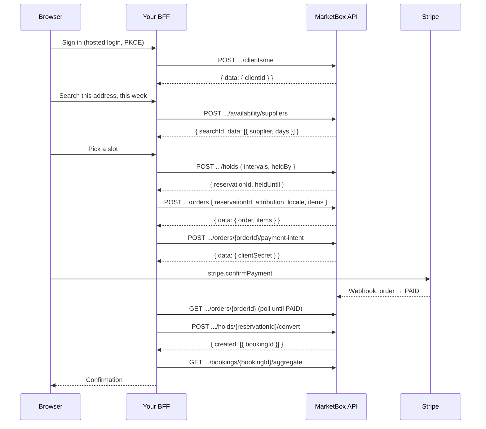

This page is the map. It walks one in-home session from sign-in to the
confirmation screen, names every call in order, and says where each common
failure lands. Each step links to the guide that covers it in depth.

The flow, in one line: **sign in → onboard → search → hold → order → pay →
convert → confirm.**

Every call below goes through your
[backend-for-frontend (BFF)](/guides/booking-flow-auth#the-bff-pattern). The
browser never holds the API key, and never sends a `clientId` your server
trusts.

## Before you start

Check these once per project. Each missing piece fails at a specific step, with
a specific error:

| You need | Without it |
| --- | --- |
| A service with `status: "LIVE"`. | Supplier profiles leave it out of their `services`, in `GET /suppliers` and on every search result, so your storefront can't show who offers it. |
| An `ACTIVE` offering of that service, with exactly one `DEFAULT` price rule. | `POST /orders` is `422 OFFERING_NOT_PRICED`, or `400 BAD_REQUEST` for an offering that isn't `ACTIVE`. |
| An `ACTIVE` `SINGLE_BOOKING` business model on the service (`PACKAGE` to sell packages). | `POST /orders` is `422 SERVICE_NOT_SOLD_AS`. |
| A supplier linked to the service, with an `ACTIVE` schedule for the offering. | Search doesn't offer that supplier. |
| A place: a `PHYSICAL` Location for venue sessions, or a travel zone on the supplier's schedule for in-home ones. | Search returns nobody for that place. See [Set up a mobile supplier's service area](/guides/set-up-a-mobile-supplier-service-area). |
| A connected Stripe account with charges enabled. | `POST /orders/{orderId}/payment-intent` is `409 CONFLICT`. See [Accept payments with Stripe](/guides/accept-payments-with-stripe#prerequisites). |
| An API key with Standard API access. | `403 CAPABILITY_NOT_GRANTED` on every call. |
| An Application with hosted sign-in, whose tokens your BFF forwards. | `401` on `POST /clients/me` for a token from another Application. See [Build a booking flow](/guides/booking-flow-auth). |

To set the catalog up from code instead of the dashboard, see
[Provision your catalog and suppliers](/guides/provision-catalog-and-suppliers).

## The flow



## Ids to store

Keep a checkout record on your server, keyed by your own checkout session id,
and write each id into it as soon as you have it. A checkout that crashes or
times out halfway can then resume or clean up instead of starting again.

<Info>
**Keep these on the checkout record.**

| Id | From | Needed for |
| --- | --- | --- |
| `clientId` | `POST /clients/me` | The order. Never from the browser. |
| `heldBy` | You: your checkout session id | Every heartbeat, and convert. Keep it stable for the whole checkout. |
| `reservationId` | `POST /holds` | The order, the heartbeat, convert, release. |
| `searchId` | The search response | The order's `attribution`. |
| `orderId` | `POST /orders`, at `data.order.orderId` | The payment intent, polling, convert, cancel. |
| `orderItemId` | `POST /orders`, at `data.items[0].orderItemId` | Convert. |
| `bookingId`s | Convert, at `created[].bookingId` | The confirmation page, and every later change. |
| `idempotencyKey` | You, once per attempt | Only when you book package credits with `.../package-bookings`, or record a payment with `.../transactions`. Reuse it on a retry. |
</Info>

## Walk through it

<Steps>
<Step title="Sign in and onboard the client">
Sign the client in with hosted login, then call `POST /clients/me` from your
BFF with the API key and their token. It's idempotent: `201` the first time,
`200` after. Take `data.clientId` from the response and keep it on your server.

If your checkout collected a name and phone, send them in the body. See
[Onboard the client](/guides/booking-flow-auth#onboard-the-client).

**Fails with:** `401 HTTP_ERROR` for a missing or expired token (sign in
again), and `403 MEMBERSHIP_INACTIVE` when the business removed this
client's access.
</Step>

<Step title="Search for open times">
Search with the client's coordinates, so in-home suppliers who cover that
address come back:

```json
// POST /v1/projects/{projectId}/availability/suppliers
{
  "serviceId": "srv_01kv60qg12e82acr78edfnjhvv",
  "offeringId": "off_01kv60qge5eh59ap0gw0pqrrys",
  "lat": 43.6532,
  "lng": -79.3832,
  "lookAheadStartDate": "2026-07-09T00:00:00-04:00",
  "lookAheadDays": 7,
  "timezone": "America/Toronto"
}
```

Keep the response's `searchId`. When the client picks a slot, keep the
supplier, the slot's `startUtc` and `endUtc`, and the supplier's own travel
zone: the `supplier.locations[]` entry with `locationType: "TRAVEL_ZONE"` and
an `stz_` id. See
[Search suppliers by availability](/guides/search-suppliers-by-availability).

A slot is not a reservation. Someone else can take it until you hold it.
</Step>

<Step title="Hold the slot">
Hold the time the moment the client picks it. The hold carries everything the
booking will need, because convert builds the booking from the hold:

```json
// POST /v1/projects/{projectId}/holds
{
  "intervals": [
    {
      "supplierId": "sup_01kv60qgnef2kt3pvqgwmkbzfr",
      "startUtc": "2026-07-09T13:30:00.000Z",
      "endUtc": "2026-07-09T14:00:00.000Z",
      "bookingTz": "America/Toronto",
      "locationType": "TRAVEL_ZONE",
      "locationId": "stz_01kv60qgs4e4nbjhzradnqtj0h",
      "latitude": 43.6532,
      "longitude": -79.3832,
      "address": {
        "addressOneLine": "100 Queen St W, Toronto, ON M5H 2N2, Canada",
        "streetNumber": "100",
        "streetName": "Queen St W",
        "city": "Toronto",
        "state": "ON",
        "country": "CA",
        "zipCode": "M5H 2N2"
      }
    }
  ],
  "heldBy": "checkout_9f2c1b",
  "holdDurationMins": 15
}
```

The `201` gives you `reservationId` and `heldUntil`. Store both. Choose a
`holdDurationMins` that covers a 3-D Secure challenge, and extend the hold
while the payment page is open: re-send the same body with the
`reservationId`. That heartbeat, and the travel-zone fields, are covered in
[Hold slots during checkout](/guides/hold-slots-for-checkout).

**Fails with:** `409 SLOT_HELD` or `409 SLOT_BOOKED` when someone else got
there first. Offer another slot; don't retry this one. A `400
VALIDATION_ERROR` names the location field you left out.
</Step>

<Step title="Create the order">
Create one order with one `SINGLE_SESSION` item. Pass the hold's
`reservationId`, so the order prices from exactly the place the booking will
happen. Add `attribution` and `locale`:

```json
// POST /v1/projects/{projectId}/orders
{
  "clientId": "cli_01kx16f0a1c7b2sd91xzq3mn5p",
  "currency": "CAD",
  "locale": "en-CA",
  "reservationId": "resv_01kx16f0a1c7b2sd91xzq3mn5p",
  "attribution": {
    "searchId": "<searchId from the search response>",
    "sessionKey": "sess-4f9a2c",
    "surface": "results"
  },
  "items": [
    {
      "skuType": "SINGLE_SESSION",
      "serviceId": "srv_01kv60qg12e82acr78edfnjhvv",
      "offeringId": "off_01kv60qge5eh59ap0gw0pqrrys",
      "quantity": 1
    }
  ]
}
```

Store `data.order.orderId` and `data.items[0].orderItemId`. Note the nesting:
the id is not at `data.orderId`. The order starts `DRAFT`.

- `currency` is the currency you showed the client. It must match what the
  region resolves to, or the order is a `400`. See
  [Regional pricing](/concepts/regional-pricing).
- `locale` is copied onto every booking this order funds, and decides the
  language of the links in MarketBox's emails. See
  [Creating an order](/resources/orders#creating-an-order).
- `attribution` ties the purchase to the search it came from. See
  [Attribution](/resources/orders#attribution).

**Fails with:** `422 OFFERING_NOT_PRICED` and `422 SERVICE_NOT_SOLD_AS` (a
setup problem: see [Before you start](#before-you-start); don't retry), and
`404 NOT_FOUND` with `Client not found` for a `clientId` that isn't in this
project.
</Step>

<Step title="Take the payment">
Create the PaymentIntent from your BFF:

```
POST /v1/projects/{projectId}/orders/{orderId}/payment-intent
```

Hand `data.clientSecret` to the browser, mount Stripe's Payment Element, and
call `stripe.confirmPayment`. Card details go straight from the browser to
Stripe. See [Accept payments with Stripe](/guides/accept-payments-with-stripe).

Calling it again for the same order reuses the open PaymentIntent, so a retry
doesn't create a second charge. It also records a `PENDING` payment on the
order, which matters if the client abandons: see
[Abandoned checkout](#abandoned-checkout).

**Fails with:**

- `409 CONFLICT`, `Project prj_… is not ready to accept card payments`: the
  business's Stripe account isn't connected, or can't take charges yet.
- `400 BAD_REQUEST`, `Order ord_… is CANCELLED; cannot take payment`: only a
  `DRAFT` or `PENDING` order takes a payment.
- `400 BAD_REQUEST`, `Order is already fully paid`: nothing is owed. Skip the
  payment step.
</Step>

<Step title="Wait for PAID, then convert the hold">
When `stripe.confirmPayment` resolves, the browser tells your BFF. The BFF
polls `GET /orders/{orderId}` until `data.status` is `PAID`, then converts:

```json
// POST /v1/projects/{projectId}/holds/{reservationId}/convert
{
  "orderId": "ord_01kx16ek2jf4r9da74adf6m4h0",
  "orderItemId": "oi_01kx16ek2kf2fsc9x7b2n1dfc9",
  "heldBy": "checkout_9f2c1b"
}
```

The `201` is **not** wrapped in `data`. Read `created[].bookingId` off the
body and store it.

The public API sends you no webhooks. Stripe tells MarketBox, and the order
flips to `PAID` a second or two later. Convert doesn't check payment, so the
order of these two calls is your choice:

- **Poll until `PAID`, then convert.** The safe default. Poll once a second
  for up to 15 seconds.
- **Convert as soon as `confirmPayment` resolves**, when `heldUntil` is close
  and you can't wait. This books before the payment is confirmed. Keep
  polling, and reconcile an order that never reaches `PAID`: see
  [Tracking state without webhooks](/concepts/tracking-state-without-webhooks).

A single session doesn't need a `PAID` order to book. A client's package
credits do, but convert doesn't enforce that for a package hold either: your
server must see `PAID` before it converts one. See
[Book a client's package credit](/guides/book-a-package-credit).

Convert is idempotent on `reservationId`. A retry after a timeout replays the
same bookings; it never books twice.

**Fails with:**

- `409 HOLD_EXPIRED`: you converted after `heldUntil`. If the time is still
  free, hold it again and convert the new hold against the same order item.
- `409 SLOT_BOOKED`: someone took the time after your hold lapsed. Offer the
  client a new time and convert a new hold against the same order item.
- `409 ORDER_CANCELLED`: the order was cancelled. Don't retry.

If the client paid and you can't book them, the money stays on the order.
The public API has no refund endpoint: the business refunds from the
MarketBox dashboard. Keeping the heartbeat running until convert returns is
what keeps you out of this case.
</Step>

<Step title="Show the confirmation">
Read the booking in full for the confirmation page:

```
GET /v1/projects/{projectId}/bookings/{bookingId}/aggregate
```

It returns the booking, its service lines and both parties' names, so the page
can say *"Tuesday at 9:30 with Priya"* without another call. The booking is
`SCHEDULED`.

Don't send your own confirmation email. Convert already sent the client their
confirmation, and the supplier their new-booking notice. See
[Emails](/concepts/emails).
</Step>
</Steps>

## Abandoned checkout

A client who closes the tab leaves a hold and, often, a `DRAFT` order. Clean
both up when your checkout session expires.

1. **Release the hold.** `POST /holds/{reservationId}/release` frees the
   supplier's time at once. It answers `200` for a released, converted or
   unknown hold, so it's safe to call blindly. Retry a
   `409 OCCUPANCY_CONTENTION`.
2. **Delete or cancel the order.** An order that booked nothing and took no
   money is noise: `DELETE /orders/{orderId}` removes it. If it holds a
   booking, or a `PENDING` or `SUCCEEDED` payment, delete refuses it. Once
   you've created a PaymentIntent, the order holds a `PENDING` payment, so an
   order abandoned on the payment page can't be deleted:

   ```json
   {
     "code": "ORDER_NOT_DELETABLE",
     "message": "Order ord_01kx16ek2jf4r9da74adf6m4h0 has 0 booking(s) and 1 payment or refund record(s) against it, so it cannot be deleted. Cancel it instead (status CANCELLED).",
     "statusCode": 409,
     "requestId": "1e6b9d3a-5c2f-4a87-b0d4-7f3e1a8c6b52"
   }
   ```

   Cancel it instead, with a reason:

   ```json
   // POST /v1/projects/{projectId}/orders/{orderId}/status
   {
     "status": "CANCELLED",
     "cancellationReason": "Checkout abandoned"
   }
   ```

A `PENDING` payment means the client may still finish paying, for example
after a bank redirect. Check the order before you cancel it: if it reads
`PAID`, convert instead, or hold again if the hold has lapsed.

For what happens to an order after checkout, such as changing its items or
cancelling it later, see
[Order lifecycle after checkout](/guides/order-lifecycle-after-checkout).

## Reference

### Endpoints used in this guide

| Step | Endpoint | Method | Auth |
| --- | --- | --- | --- |
| Onboard | `/v1/projects/{projectId}/clients/me` | `POST` | `x-api-key` + `Bearer` |
| Search | `/v1/projects/{projectId}/availability/suppliers` | `POST` | `x-api-key` |
| Hold, heartbeat | `/v1/projects/{projectId}/holds` | `POST` | `x-api-key` |
| Order | `/v1/projects/{projectId}/orders` | `POST` | `x-api-key` |
| Pay | `/v1/projects/{projectId}/orders/{orderId}/payment-intent` | `POST` | `x-api-key` |
| Poll | `/v1/projects/{projectId}/orders/{orderId}` | `GET` | `x-api-key` |
| Convert | `/v1/projects/{projectId}/holds/{reservationId}/convert` | `POST` | `x-api-key` |
| Confirm | `/v1/projects/{projectId}/bookings/{bookingId}/aggregate` | `GET` | `x-api-key` |
| Abandon | `/v1/projects/{projectId}/holds/{reservationId}/release` | `POST` | `x-api-key` |
| Abandon | `/v1/projects/{projectId}/orders/{orderId}` | `DELETE` | `x-api-key` |
| Abandon | `/v1/projects/{projectId}/orders/{orderId}/status` | `POST` | `x-api-key` |

### Where each failure lands

| Step | Status and `code` | What to do |
| --- | --- | --- |
| Onboard | `401 HTTP_ERROR` | Sign the client in again. |
| Onboard | `403 MEMBERSHIP_INACTIVE` | The client asks the business to invite them again. |
| Hold | `409 SLOT_HELD`, `409 SLOT_BOOKED` | Offer another slot. |
| Hold | `400 VALIDATION_ERROR` | Send every location field the `locationType` needs. See [Hold slots during checkout](/guides/hold-slots-for-checkout#troubleshooting). |
| Order | `422 OFFERING_NOT_PRICED` | The offering needs a `DEFAULT` price rule. Fix the setup. |
| Order | `422 SERVICE_NOT_SOLD_AS` | The service needs an active `SINGLE_BOOKING` business model. Fix the setup. |
| Order | `400 BAD_REQUEST`, `Item … currency … does not match order currency …` | The region resolved a different price. Pass `reservationId`. |
| Pay | `409 CONFLICT` | The business finishes Stripe onboarding. |
| Pay | `400 BAD_REQUEST` | The order isn't `DRAFT` or `PENDING`, or nothing is owed. |
| Convert | `409 HOLD_EXPIRED` | Hold again, then convert. |
| Convert | `409 SLOT_BOOKED` | Offer a new time; convert a new hold against the same order item. |
| Convert | `409 ORDER_CANCELLED` | Don't retry. |
| Convert | `404 NOT_FOUND`, `Location stz_… not found` | The hold has the wrong `locationType`. See [the travel-zone walkthrough](/guides/hold-slots-for-checkout#a-travel-zone-checkout-end-to-end). |
| Any | `409 OCCUPANCY_CONTENTION` | Retry after a short backoff. |
| Abandon | `409 ORDER_NOT_DELETABLE` | Cancel the order with a `cancellationReason` instead. |

See [Errors](/concepts/errors) for the envelope and retry rules.
